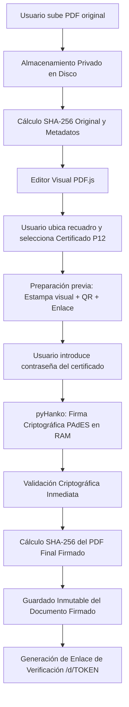

# Arquitectura General de SignBox

## 1. Visión y Enfoque

SignBox está concebido como un SaaS monolítico en **Django 5.2**, robusto, seguro y mantenible, sin sobreingeniería innecesaria (sin microservicios, sin Celery ni Redis en la primera versión). Toda la operativa funciona mediante vistas Django estándar, formularios tipados, plantillas HTML modernas con Bootstrap 5 y reactividad ligera con Alpine.js.

## 2. Diagrama de Flujo Documental

## 3. Estructura Modular de Aplicaciones

El código está organizado en `apps/` con responsabilidades estrictamente delimitadas:

- **`apps/accounts/`**: Modelo `User` personalizado (autenticación estricta por email único), registro, inicio/cierre de sesión y perfil.
- **`apps/workspaces/`**: Modelo `Workspace` para aislamiento multitenant. Cada recurso documental o certificado pertenece a un espacio privado.
- **`apps/certificates/`**: Bóveda de certificados PKCS#12 (.p12/.pfx). Cifrado simétrico autenticado (Fernet / AES-CBC + HMAC-SHA256) en reposo con claves maestras fuera del código y de la base de datos.
- **`apps/documents/`**: Gestión documental, control de estados (`uploaded`, `preparing`, `signing`, `signed`, `failed`), hashes SHA-256 y capa de almacenamiento desacoplada (`storage.py`).
- **`apps/signing/`**: Motor de firma criptográfica con pyHanko (`PyHankoSignatureProvider`), transformador de coordenadas (`coordinates.py`) y generador de apariencia visual con QR (`appearance.py`).
- **`apps/sharing/`**: Enlaces públicos de verificación con tokens de alta entropía. Se persiste únicamente el hash SHA-256 del token para evitar accesos indebidos.
- **`apps/tracking/`**: Registro cronológico de visitas web, previsualizaciones, descargas y solicitudes remotas (`pdf_resource_request`) con anonimización de IP (RGPD).
- **`apps/verification/`**: Comparador y validador de documentos. Distingue coincidencia byte a byte de validez matemática independiente de la firma.
- **`apps/audit/`**: Registro de auditoría sensible para operaciones de seguridad (sin guardar contraseñas ni claves).
- **`apps/core/`**: Middlewares de cabeceras de seguridad, validadores de archivos binarios y utilidades hash.

## 4. Abstracción de Almacenamiento

El almacenamiento documental utiliza la interfaz `DocumentStorageInterface` en `apps/documents/storage.py`:
- En el MVP, la implementación predeterminada `LocalDocumentStorage` guarda los archivos fuera del directorio raíz web (`private_storage/`), garantizando descargas autorizadas mediante streaming protegido.
- En la Versión 2, la integración con Google Drive u otros proveedores S3 implementará la misma interfaz sin alterar los modelos ni las vistas.
